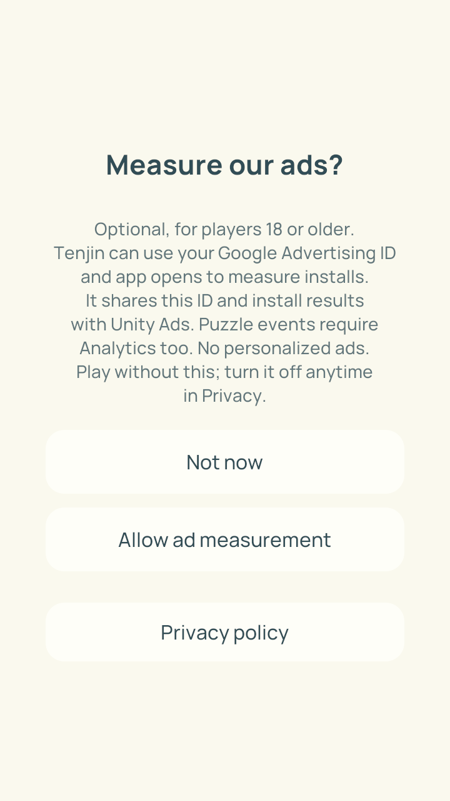

# Separate adult ad-measurement consent — 19 November 2026

Status: isolated Android QA APK built, 39 automated tests passed, consent UI rendered and inspected. **Not a production rollout or proof of paid-install attribution. Unity campaign has not been activated by this work.**

## Decision and support evidence

The owner explicitly approved a new, separate, voluntary choice for players 18 or older to let Tenjin use GAID and send install postbacks to Unity. This replaces the earlier decision to block GAID for everyone. The existing “Allow analytics” choice must never grant this new permission. Under-18, unknown-age and refusing players remain excluded from Tenjin attribution.

Source: the owner's screenshot of Sean's response in Unity Growth Support ticket #00946121. The full Gmail thread and current Unity dashboard could not be opened in this chat. The reply says live Unity CPI attribution cannot use Play Install Referrer alone without GAID, Android ID or IP matching; there is no documented identifier-free child/unknown-age alternative. An event accepted by Tenjin is not an attributed Unity install.

Measurement is limited to consenting adults with an available GAID, not all downloads. The game currently targets ages 9–15, so this subset may be small and unrepresentative; successful technical attribution would not establish campaign profitability or guarantee Unity delivery. Do not present this measured CPI as the CPI of all players.

## Implemented scope

- Privacy save v3 migrates existing players with ad measurement **off and undecided**, even when Analytics was previously on. Progress, inventory and other game saves are untouched.
- Only adults see an independent disclosure and equally styled “Not now” / “Allow ad measurement” buttons. No reward, preselection or requirement to agree. Review in Privacy does not itself grant permission; “turn off” revokes it.
- Tenjin is created only after separate adult consent. Revocation/age changes suspend the session, call SDK OptOut and invalidate the revision permit; no app-level event queue. Reconnect reapplies the parameter exclusions.
- GAID is the only newly permitted advertising identifier. Android ID, App Set ID fields, IP and the previous fingerprinting-related parameters remain in OptOutParams. DMA opt-out remains. No identifier fallback is added.
- App-open/install measurement may be allowed while gameplay Analytics is refused. Sending the three bounded puzzle event types additionally requires Analytics consent.
- This does not assert that a withdrawn request already in flight is cancelled, or that a deleted/zero GAID can attribute an install. Those are native/device verification items.

## Why QA is isolated

Android `AD_ID` is an app-wide normal manifest permission, not a permission private to Tenjin. Merely gating Tenjin while restoring it could make it available to another SDK. Therefore this first QA build suppresses Firebase, AdMob and UMP initialization, retains removal of their automatic providers, and uses the no-ads provider. It is **not** an ad-serving QA build.

The production builder still removes AD_ID and AdServices permissions and excludes the QA define. Production Tenjin remains disabled. Child/teen contextual-ad behavior in the ordinary production build is unchanged. A combined production release needs a separate native SDK audit to prove that adding AD_ID cannot cause child/unknown/refusing-user collection by any other SDK; do not remove that release gate because this isolated test passes.

## Build and verification

Editor command: `Gravity Box → COghe → Build adult attribution QA APK` (`COgheAndroidBuilder.BuildAdultAttributionQa`). Output: `Builds/AlienPetAttributionQA/AlienPet-attribution-qa.apk`, version name `1.0.8-attribution-qa`. Invoke with `COGHE_STORE=1` to leave developer level-selection tools out. The temporary QA flag and version are restored in `finally`.

Final artifact: 59,241,745 bytes. [Build proof and SHA-256](build-proof.json). The packaged manifest was checked with `aapt`: AD_ID present, AdServices permissions and Google automatic initialization providers absent, Firebase collection/ad-ID defaults false. Generated IL2CPP also confirms the QA Google-services bootstrap is empty. These static checks do not replace native network testing. The local debug APK retains version code 1 and is not an update for the Google Play-signed OPPO installation.

Automated evidence is in `Artifacts/AlienPetAdultAttribution20261119/` (local generated output, not source assets):

- `privacy.xml`: 34 EditMode tests passed, including migration, consent separation, blocked age bands, revocation, reconnect and production/QA manifest differences.
- `ui.xml`: 5 PlayMode tests for the actual consent buttons, rejection/review/revocation, teen exclusion and existing age/privacy flows. Phone/tablet safe-area assertions are included.
- `adult-consent.png`: rendered UI proof; not a device capture.

No OPPO was visible through ADB during preparation. No player app was uninstalled, no data was cleared, no Google Play release was uploaded and no dashboard/billing setting was changed.

## Remaining release gates

1. Use a separately consented adult test device, retain the owner's OPPO saves. A debug APK cannot replace a Google Play-signed app while preserving its signing identity. For the real attribution test, prepare an upload-key-signed Internal testing AAB after checking the next unused Play version code.
2. Verify unknown/minor/refusing states send no Tenjin requests, adult consent permits GAID, opt-out stops further events/reconnects, deleted/limited ID has no Android-ID/IP fallback. Do not retain raw GAID in reports.
3. Read the full support thread, keep probabilistic modelling off, verify Tenjin's Unity install callback and Game ID `800440996`, and the campaign click/impression links. Do not broaden data-sharing callbacks.
4. Perform the vendor-supported fresh Play install test on a separate adult device. An update retains its old referrer and is insufficient. Confirm an attributed install in Tenjin **and an accepted install postback in Unity**, not just HTTP 200 or an organic app open. Resolve the paused campaign's creative/test-access requirements with support without starting paid traffic just to test ingestion.
5. Before a combined production rollout, update the public privacy disclosure and Google Play Data Safety/Advertising ID declaration to match the actual build, and verify the shared AdMob/Firebase SDK behavior with AD_ID present. Keep all existing minor protections.
6. Only after attribution is proven, revisit activation within the owner's separate US Unity budget (250,000 VND/day). Do not treat the Google Ads worldwide budget as Unity authorization or alter existing Google campaigns.

References: [Unity link parameters](https://docs.unity.com/en-us/grow/acquire/partner-integration/attribution/link-parameters), [Tenjin Unity setup](https://tenjin.com/docs/unity-ads-setup/), [Google Play Families](https://support.google.com/googleplay/android-developer/answer/9893335?hl=en), [AdMob data disclosure](https://developers.google.com/admob/android/privacy/play-data-disclosure).
