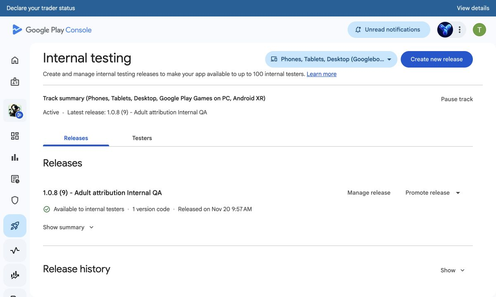
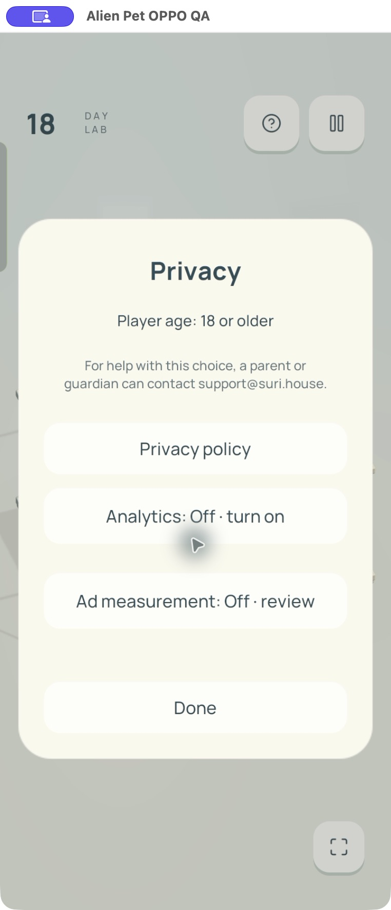

# Adult attribution Internal QA — 20 November 2026

## Scope

Install and verify the separate adult ad-measurement consent approved by the owner, preserving OPPO progress. Unity campaigns remain paused; this is not authorization to promote the isolated QA artifact to Production. The ordinary build retains the existing minor protections and identifier restrictions.

Implementation and 39 passing automated tests: [19 November report](../AlienPetAdultAttribution20261119/README.md).

## Artifact and distribution

- Explicit builder: `COghePlayStoreBuilder.BuildAdultAttributionInternal`; requires `-attribution-qa` version suffix, restores the temporary build flag, and rejects mixing child-ad and adult-attribution QA. Ordinary production build still rejects the attribution QA flag.
- Version `1.0.8-attribution-qa`, version code **9**, package `com.gravityboxlab.venom`.
- Signed AAB: `Builds/AlienPet/GooglePlay/AlienPet-1.0.8-attribution-qa-9.aab`.
- AAB SHA-256: `e0307e86feaf5fded2f375b14cae6389b265b8fc6186c93419ce11ced3313093`.
- Original upload certificate matched; bundletool/signature validation passed; all packaged native ELF files and bundle support 16 KB; Android tablets remain supported.
- Packaged manifest contains AD_ID only for this isolated QA; AdServices and automatic Google SDK initialization providers remain absent. Firebase collection defaults false. QA suppresses Firebase/AdMob/UMP initialization and ad serving. These static checks are not a packet-capture audit.
- Play accepted the AAB and matching native symbols. **Available to internal testers**, release `1.0.8 (9) - Adult attribution Internal QA`, 20 November 09:57 local. Production version 8 in review was left untouched.

## OPPO update and test status

Baseline OPPO CPH2591: Google Play version `1.0.6-child-qa (7)`, first install `2026-11-02 08:55:28`, last update `2026-11-18 10:30:10`. Main menu showed **235 Drops**, existing pet appearance and an unfinished Understand COghe step. No uninstall or clear-data command was used.

Opening the Play update was intercepted by OPPO App Market. After the owner's update attempt, package inspection still showed version 7. A Google Play-signed universal APK for version 9 was downloaded from Play Console. Its signing certificate matches the installed app exactly:

- Play certificate SHA-256: `340ab8fe7ec24a04292dc9efa82c4e693e76da8291d79e66a12f038d0c0f6c89`.
- APK SHA-256: `d01555e54f5a04ffd4582520dd6ba934b0b82b4cbfc4d632fa38c302133139ad`.

`adb install -r` returned **Success**. Package inspection at 10:03:31 confirmed version 9, first-install time unchanged and last update 10:03:00. This is a USB update of the Google-signed artifact, **not a fresh Play install**; Android reports installer `null` for that update. No installer identity was spoofed.

The first USB launch reached Google's **Get this game from Play** installer-check screen. The owner followed **Get game** and completed the Play step. Final package inspection at 10:05:30 confirms version 9, installer **com.android.vending**, last update **10:04:43**, first install still **2026-11-02 08:55:28**. No protection was disabled and no installer identity was spoofed. The game opens correctly; **235 Drops**, existing pet appearance and the pending Understand COghe progression remained intact.

Both app-level probabilistic attribution windows were verified Off during this session. No campaign, billing or callback settings were changed.

## Real-device results

- Existing age remains **18 or older**. Initial **Measure our ads?** disclosure appeared without inheriting Analytics permission. The owner selected **Not now**; Privacy visibly showed Analytics Off and Ad measurement Off. Native log snapshot contained no Tenjin lines.
- The owner enabled Analytics alone, reporting Ad measurement stayed Off; the following native log snapshot still contained no Tenjin lines. The Privacy panel was closed by that time, so this intermediate toggle state is user-reported plus logs, rather than an independent UI capture.
- The owner then reviewed and explicitly allowed ad measurement. Privacy was independently observed with both choices On.
- At **10:07:36.783**, native Tenjin diagnostics show a request for `1.0.8-attribution-qa` with a nonzero GAID and response **200 / success true**. No raw GAID or SDK key is retained in the device report.
- At **10:08:42.488**, `level_start=17` was sent and accepted (**200 / success true**). The observed request excludes `developer_device_id`, `developer_device_id_scope`, `android_id` and `ip_address`; those names remain explicitly opted out, while `advertising_id` is not opted out after adult consent.
- The owner completed level 17. **10:09:40.566** `level_complete=17` and **10:09:43.956** `level_start=18` were also accepted, each **200 / success true**. After the Understand COghe/level test, the main menu shows **Level 18 and 275 Drops**; no save editing was used.
- Tenjin Integration Status now independently reports **App Open received** and **Custom Event received** for **1.0.8-attribution-qa**. Referrer Install is **not received** for this version; the older version's received referrer is not evidence for this update. No paid-install attribution claim is made.
- No fatal exception/signal marker was found in the sampled app log buffers. This is a bounded functional test, not a soak/performance test or packet-capture audit. Absence of logs alone does not prove absence of every network packet.
- Both choices were restored **Off**, independently observed in Privacy on level 18. The app was force-stopped and relaunched without clearing data. At **10:11:59**, the new process's available log buffer contained no Tenjin/HTTP transport lines and no fatal-crash marker; main menu opened at **Level 18 / 275 Drops** without another consent prompt. This verifies the sampled restart behavior, not cancellation of requests already in flight.

Tenjin's integration table was read directly through its UI. Its screenshot crop did not capture the intended table, so that invalid image is not retained as evidence; the local sanitized native reports preserve accepted responses. SDK keys and raw identifiers are excluded from these reports.

## Remaining checks

1. Unknown/minor migration, refusal, revocation and independent Analytics gating passed the existing automated suite. This OPPO session did not change the owner's saved age to impersonate a minor, and did not test deleting the device GAID.
2. Fresh Unity-attributed install and accepted Unity postback require a separate test; this data-preserving update cannot establish paid-install attribution. Do not activate campaign based on ingestion alone.
3. Retain the production release gates in the 19 November report, including the shared native SDK audit and public disclosures. This isolated QA build disables ad serving and must not be promoted to Production.

Local build, validation and sanitized-device evidence: `Artifacts/AlienPetAdultAttribution20261120/`. No raw GAID is written by `read_device_proof.py`.
