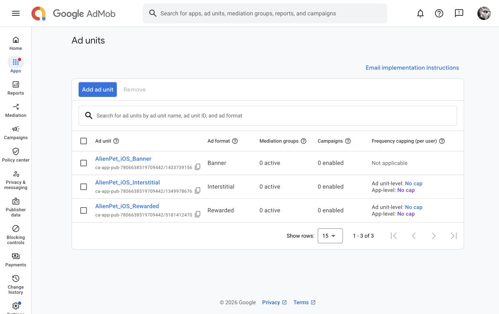
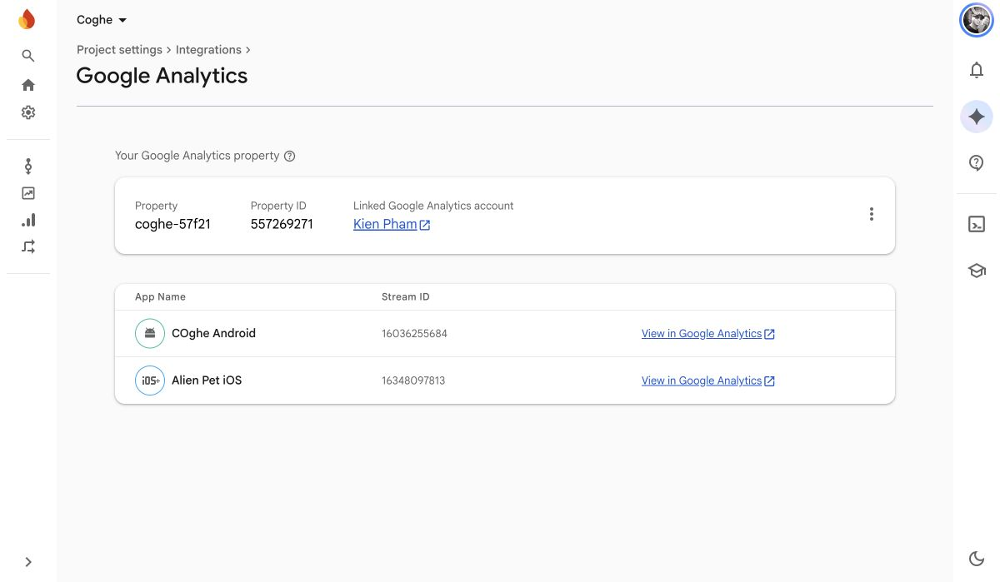
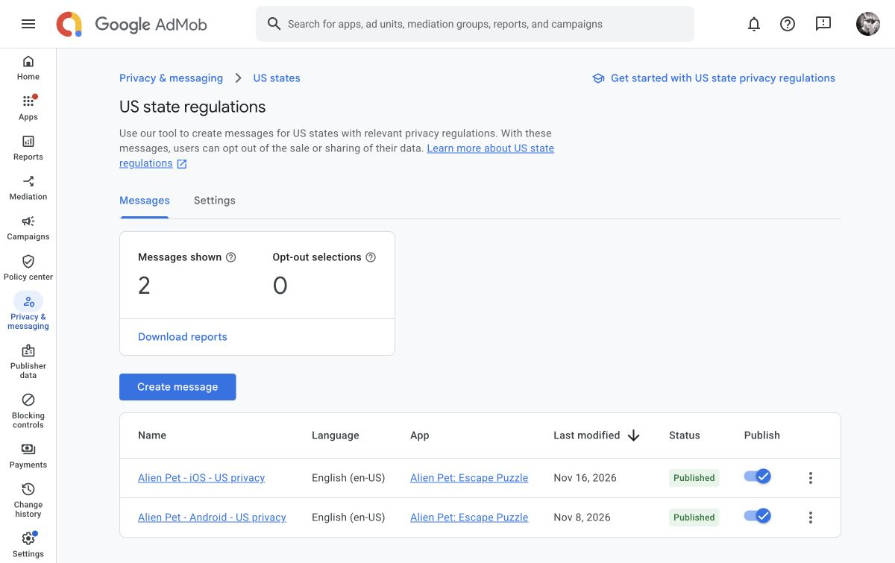

# Alien Pet iOS services — 16 November 2026

Branch **IOS**, based on NewGraphic b8b69f03. Scope: real Google cloud configuration + iOS adapter/config/build handoff. Gameplay, rewards, ad placements and age rules remain unchanged.

## Cloud result

- Created Alien Pet iOS AdMob app and three units (banner/interstitial/rewarded), distinct from Android.
- Created Firebase iOS app in coghe-57f21 with bundle com.gravityboxlab.venom; downloaded matching config; created Analytics stream 16348097813 in existing property 557269271.
- Linked the iOS app between AdMob and Firebase; published separate English EU consent and US privacy messages for this iOS app only.
- iOS app is not listed in App Store yet: AdMob reports Requires review / limited serving. Add listing after Apple app identity exists.

Exact IDs, policy and receiving-machine tasks: [IOS-SERVICES.md](../../Marketing/AlienPet/AppStore/2026-11-16/technical/IOS-SERVICES.md).

## Tests and build

- **12/12 EditMode tests**: age/consent permissions, native closed defaults, config/version guard negatives, existing Android protections.
- **8/8 PlayMode monetization tests**: placement/entitlement/cap/reward behavior using controlled providers. These do not show real ads.
- **24/24 generated Xcode project checks**: correct IDs, native privacy flags, Firebase inclusion, workspace/Pods, icon and manifest presence.
- Clean store-wrapper invocation `bash Tools/build-alienpet-ios-store.sh 1.0.0 1` completed successfully, exporting 67 catalog scenes (65 main campaign + 2 prototypes).
- Approved icon C now replaces stale iOS-specific slots. Actual exported 1024 icon visually inspected after export; handoff icon agrees.
- Release ARM64 native build compiled/linked without signing. Native app bundle/config, phone+tablet targeting and privacy manifests inspected. Xcode logs include third-party/deprecation and dSYM module-path warnings; final distribution archive must be validated by the receiving Mac.

Machine: Unity 6000.3.19f1, Xcode 26.6 (17F113), iOS SDK 26.5. Resolved: Google Mobile Ads native 13.11.0, UMP 3.1.0, Firebase native 12.19.0 / Unity 13.17.0. Firebase resolves via Swift packages; Google ads via CocoaPods. No Apple account, provisioning profile, signing key, archive upload or production ad clicks were used.

Local ignored outputs: Artifacts/AlienPetIOS/{privacy.xml,monetization.xml,store-wrapper.log,xcode-unsigned.log}; Builds/SpatialLab/iOS; Builds/SpatialLab/iOS-Unsigned. Compact results in test-results.json and export-audit.json are versioned here. Source test results preceded cleanup of an unreachable builder fallback; final export compiles the cleaned builder and icon change.

## Limits and follow-up

No fresh iPhone/iPad SDK runtime test, TestFlight, production fill/revenue, IAP purchase or App Store validation was performed. Device QA rows remain NOT_RUN. Check actual iOS DebugView level_complete/level_fail/rewarded_earned/ad_revenue only with permitted adult opt-in; test refusal/under13/teen behavior separately. Test ads may report zero revenue. StoreKit provider, native screenshots and policy review remain listed in the release plan. Existing Android behavior was preserved in source; no new Android device regression run in this task.

## Console evidence

## Swift resource packaging correction

The first successful native build contained only Unity/GMA/UMP manifests. Firebase Swift resource bundles existed in build products but were absent from the app. The exporter now adds an app-target phase using Tools/copy-alienpet-ios-swift-resources.sh, after the framework dependency and before app signing. It copies only built Firebase/GoogleUtilities/Promises/nanopb vendor bundles, retaining their original manifest contents; missing required Firebase manifests fails the build. No fabricated vendor declarations are generated.

A temporary fixture verified byte preservation, spaces in paths, repeat execution, exclusion of unrelated bundles and failure on missing required manifests. Final native evidence is in native-build.json; distribution Archive/Validate still belongs to the receiving Mac. Apple documents these manifest requirements at https://developer.apple.com/support/third-party-SDK-requirements/.
